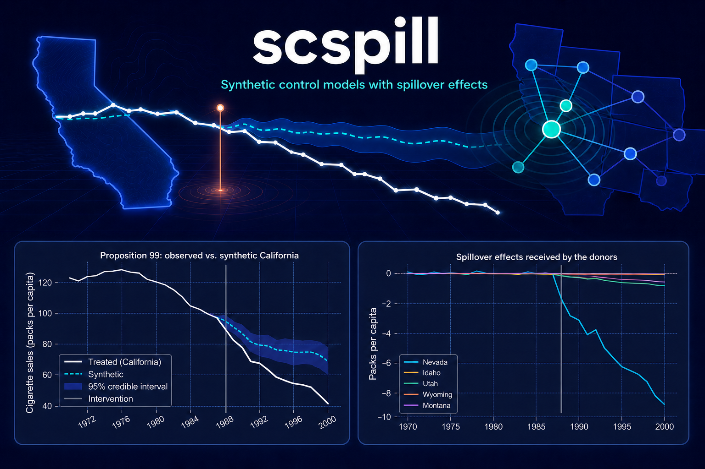

---
---

{fig-align="center" fig-alt="scspill — conceptual spillover network above dark-themed observed-versus-synthetic California and donor spillover plots"}

::: {.text-center}
**Synthetic control when the treatment leaks: estimate the policy effect *and* the spillover received by every donor.**
:::

**scspill** is a Python package of synthetic control models with spillover
effects. Classical synthetic control assumes the donors are untouched by the
treatment; when a policy spills across borders or trade links, that
assumption fails and the estimate is biased. Every model here drops it, and
every model returns two things classical synthetic control cannot both give
you: the effect on the treated unit, purged of contamination, and the
spillover effect received by each donor.

Two models ship today, behind one configuration and one result type:

- [`sar`](models/sar.qmd) (the default) is the Bayesian spatial-autoregressive
  method of Sakaguchi & Tagawa (*The Econometrics Journal*). It models the
  leakage through user-supplied spatial weights, a horseshoe-regularized donor
  fit, and one estimated spillover intensity $\rho$.
- [`cd`](models/cd.qmd) is the method of Cao & Dowd (arXiv:1902.07343v3).
  Every unit gets its own synthetic control, a known exposure structure
  separates the direct effect from each spillover, and end-of-sample P tests
  give the inference.

The [model catalogue](models/index.qmd) compares them, names the models on
the roadmap, and marks plainly which are implemented.

```{=html}
<div class="hero-cta">
  <a class="xpd-btn xpd-btn--app" href="get-started.qmd">Get started &rarr;</a>
  <a class="xpd-btn xpd-btn--ghost" href="models/index.qmd">Browse the models</a>
  <a class="xpd-btn xpd-btn--ghost" href="https://github.com/quarcs-lab/scspill" target="_blank" rel="noopener">&#11088; Star on GitHub</a>
</div>
```

::: {.grid}

::: {.g-col-12 .g-col-md-4 .module-card}
### [🎯 Estimate](get-started.qmd)
Pick a model, configure once, fit once. `SCSPILL(config).fit()` returns the
ATT, the counterfactual path, and a **time-by-donor spillover panel** for
either model. **`sar`** runs a two-step Bayesian sampler; **`cd`** fits an SCM
per unit and tests any spillover hypothesis.

```{=html}
<div class="module-card__links">
  <a href="https://colab.research.google.com/github/quarcs-lab/scspill/blob/main/notebooks/california.ipynb" target="_blank" rel="noopener">▶ Open in Colab</a>
</div>
```
:::

::: {.g-col-12 .g-col-md-4 .module-card}
### [🔬 Validate](articles/validation.qmd)
`sar` ships its article's appendix machinery as first-class functions: the **Geweke joint distribution
test** of the sampler, **prior sensitivity** sweeps, and **prior predictive
checks** against nine statistics of the donor panel.
:::

::: {.g-col-12 .g-col-md-4 .module-card}
### [🎲 Simulate](articles/simulation-study.qmd)
`sar`'s **Monte Carlo engine**: plant $\rho$ and the treatment effect on
a lattice, watch classical SCM go wrong under spillovers, and score bias,
RMSE, and coverage across estimators.
:::

:::

## The models

| Model | `method` | Reference | Status |
|---|---|---|---|
| [Bayesian spatial-autoregressive spillover SCM](models/sar.qmd) | `"sar"` | Sakaguchi & Tagawa (2026), *Econometrics Journal* | **Available** |
| [Synthetic control under a known spillover structure](models/cd.qmd) | `"cd"` | Cao & Dowd, arXiv:1902.07343v3 | **Available** |
| Inclusive synthetic control | `"iscm"` | Di Stefano & Mellace (2024) | Planned |
| Partial-interference SCG | `"grossi"` | Grossi et al. (2025), *JRSS-A* | Planned |

The remaining planned rows are a roadmap. Their `method` names are rejected. The
[model catalogue](models/index.qmd) explains what each would assume, and why
having several matters — the assumptions are not nested, so two models
bracket the answer.

## What a `sar` fit needs and returns

The treated unit is matched by unconstrained, horseshoe-shrunk synthetic
weights $\alpha$ (donors can be excluded, weighted negatively, or extrapolated
— no simplex constraint). Spillovers travel through weights you specify:
`spatial_w` links the treated unit to each donor, `spatial_W` links donors to
each other, and a single scalar $\rho$ — estimated by random-walk Metropolis
inside a Gibbs sampler — scales the whole channel. At $\rho = 0$ the method
collapses exactly to the Bayesian horseshoe synthetic control.

| You provide | scspill returns |
|---|---|
| a long panel `df` (one row per unit-period) | `att`, `att_ci` — the treatment effect with credible interval |
| a 0/1 treatment column | the counterfactual path with a pointwise credible band |
| `spatial_w`, `spatial_W` — spatial weights by donor label | the posterior of $\rho$ (draws, interval, ESS, acceptance) |
| optional covariate columns | a $(T \times N)$ spillover panel with credible bands per donor |
|  | MCMC diagnostics and R-style plot panels |

## What a `cd` fit needs and returns

Every unit gets an intercept-adjusted simplex synthetic control. You state
which controls the treatment can reach, and how:

- named units with free effects (`affected_units`);
- one effect shared by a group (`spillover_structure="homogeneous"`);
- a spillover decaying with distance (`"distance_decay"`);
- any exposure matrix (`"custom"`).

The model separates the direct effect from each spillover in every
post-treatment period.

| You provide | scspill returns |
|---|---|
| a long panel `df` and a 0/1 treatment column (one or several treated units) | `effects_panel` — every unit's effect by period |
| the exposed units, or a structure | `effect_ci`, `pointwise_p_values` — pointwise intervals and P tests |
|  | `test_hypothesis(C)` — any linear hypothesis, e.g. "no spillover anywhere" |
|  | `kappa_test`, `select_structure_by_kappa()` — is the structure right? |
|  | `cd.sensitivity` — how much a missed spillover could bias the result |

## Bundled case studies

- **California Proposition 99** — 39 states, 1970–2000, per-capita cigarette
  sales, rook-contiguity weights (`scspill.data.load_california()`): the
  `sar` paper's tobacco-tax application, where the spillover lands on Nevada.
- **[Proposition 99 with a known structure](prop99-spillovers.qmd)** — Cao &
  Dowd's 50 states plus DC, 1970–2000, with the 13 exposed states
  (`scspill.data.load_california_cd()`). The `cd` model finds leakage into
  Nevada, and the page sets it beside `sar`.
- **The 2011 Sudan secession** — 34 African countries, 2000–2015, GDP per
  capita, bilateral-trade weights (`scspill.data.load_sudan()`): spillovers
  travel the trade network to Egypt and Kenya.

## Installation

```bash
pip install scspill            # NumPy/SciPy backend
pip install "scspill[numba]"   # + JIT-compiled samplers (~10x faster)
```

## At a glance

```python
from scspill import SCSPILL
from scspill.data import load_california

panel = load_california()
result = SCSPILL({**panel.config_kwargs(), "m_iter": 20_000, "burn": 10_000,
                  "seed": 42}).fit()

result.att, result.att_ci          # treatment effect on California
result.rho_hat, result.rho_ci      # spillover intensity
result.spillover_panel["Nevada"]   # the effect received by Nevada
result.plot(kind="panel")          # counterfactual | effect | top spillovers
```

```python
from scspill.data import load_california_cd

cd = SCSPILL(load_california_cd(51).config_kwargs()).fit()   # method="cd"
cd.effects_panel[["CA", "NV"]]     # direct effect and Nevada's spillover, by year
cd.effect_ci["NV"]                 # their pointwise 95% intervals
cd.plot(kind="spillover")          # every exposed state's effect
```

## Validated, not just implemented

Every release is cross-validated against the authors' R replication package
(see the [validation article](articles/validation.qmd) and
`benchmarks/REPORT.md` in the repository): the California and Sudan
posteriors are matched against the frozen R credible intervals, the Monte
Carlo grid against the paper's Tables 1–2, and the sampler itself passes the
Geweke joint distribution test — which also caught, and led us to fix, two
internal inconsistencies in the reference implementation's latent-factor
block.

`cd` is checked against three independent sources (see
[Replicating Cao & Dowd](articles/cd-replication.qmd)):

- **the paper:** the significance of the early years, and Figure 3's
  break-even points 17.07 and 9.66;
- **the authors' code:** every P value of their Proposition 99 output, and
  their simulation statistics;
- **mlsynth's implementation:** to solver tolerance.

## Built on

[numpy](https://numpy.org) · [scipy](https://scipy.org) ·
[pandas](https://pandas.pydata.org) · [pydantic](https://docs.pydantic.dev) ·
[matplotlib](https://matplotlib.org) · optional
[numba](https://numba.pydata.org) — and designed to sit beside
[mlsynth](https://github.com/jgreathouse9/mlsynth), whose estimator
architecture it shares.

## Citing

If you use scspill, please cite it as:

> Mendez, C., Sakaguchi, S., & Tagawa, H. (2026). *Synthetic Control Models
> with Spillovers in Python* (version 0.2.1).
> <https://github.com/quarcs-lab/scspill>

Authors: [Carlos Mendez](https://carlos-mendez.org) ·
[Shosei Sakaguchi](https://sites.google.com/view/shoseisakaguchi/home) ·
[Hayato Tagawa](https://hayataga.github.io/HayaTaga/)

`CITATION.cff` in the repository carries the same metadata in
machine-readable form.

## Acknowledgement

The library's design, syntax, and infrastructure are based on Jared
Greathouse's [mlsynth](https://github.com/jgreathouse9/mlsynth), a larger and
more comprehensive package of synthetic control methods. The documentation
stack follows [geometrics](https://github.com/quarcs-lab/geometrics), from the
[QuaRCS lab](https://quarcs.netlify.app/), where scspill is developed. The
`sar` model is cross-validated against the MIT-licensed [replication
package](https://doi.org/10.5281/zenodo.19066186) for the article it
implements.
